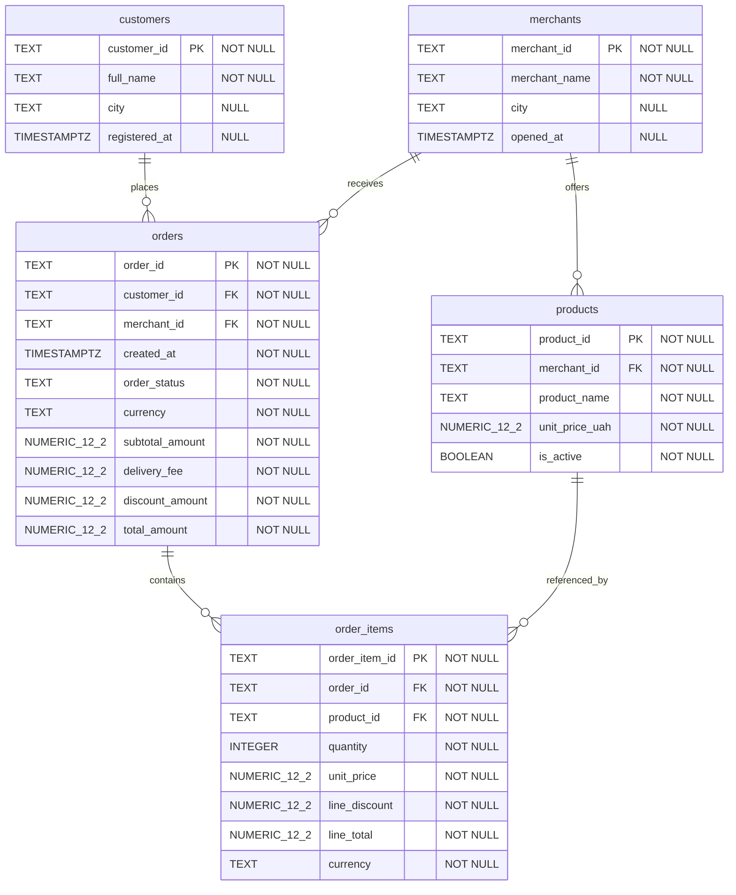

# ER-діаграма PostgreSQL — Lab 02

- customers — один рядок на одного клієнта.
- merchants — один рядок на одного продавця.
- products — один рядок на один товар.
- orders — один рядок на одне замовлення.
- order_items — один рядок на одну позицію замовлення.

Усі первинні ключі — стабільні бізнес-ідентифікатори типу TEXT.

## Схеми PostgreSQL

- stg — початкові дані та метадані завантаження.
- core — перевірені бізнес-дані.
- audit — результати перевірок та історія запусків.
